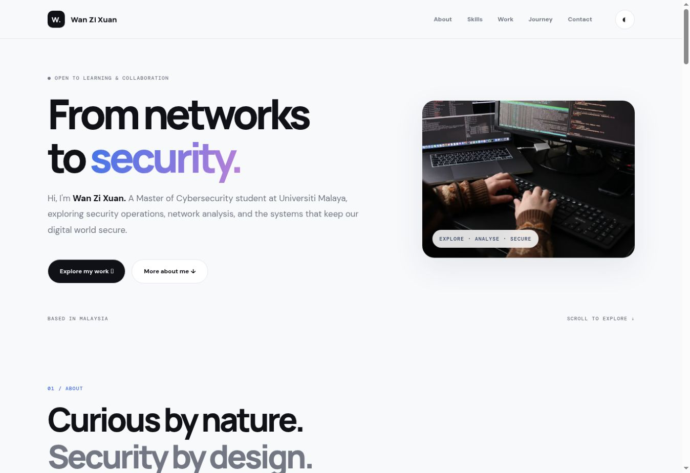

# Wan Zi Xuan — Cybersecurity Portfolio

An Apple-inspired, responsive cybersecurity portfolio with light and dark themes. Showcasing my academic journey, technical skills, cybersecurity projects, and research as a Master of Cybersecurity student at Universiti Malaya.

### 🌐 [Visit My Cybersecurity Portfolio](https://wan-notone.github.io/cybersecurity-portfolio/)

*Click the screenshot to explore the live website.*

Built with HTML, CSS, and JavaScript. To preview locally, open `docs/index.html` in a browser.
